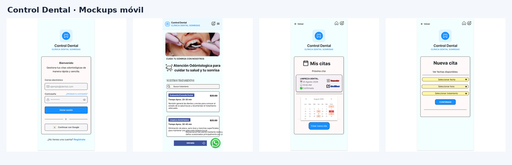

# Control Dental | Aplicación móvil

**Control Dental** es una aplicación de **Clínica Dental Sonrisas** que permite a los pacientes consultar tratamientos, gestionar citas y acceder a información de la clínica.

**Proyecto académico:** DPS941 · Universidad Don Bosco · Ciclo II, 2026 · Grupo C.

**Panel administrativo:** [Control Dental Web](https://github.com/michellec91/controldental-dps).

## Funcionalidades

- Registro, inicio y cierre de sesión con **Firebase Authentication** (correo y contraseña).
- Consulta de tratamientos y gestión de citas: solicitudes, cambios, cancelaciones e historial.
- Perfil de paciente y datos asociados a su cuenta.
- Modo **claro, oscuro y automático**, con preferencias almacenadas en **Firestore**.
- Información de la clínica y mapa interactivo, adaptado al tema en Android y Expo Web.

## Tecnologías

**React Native · Expo SDK 57 · TypeScript · Expo Router · Firebase Authentication · Cloud Firestore · OpenStreetMap**.

La aplicación también utiliza la **API REST (Node.js y Express) y MySQL** del [repositorio web](https://github.com/michellec91/controldental-dps) para determinadas operaciones. Firestore y MySQL cumplen funciones complementarias en esta versión.

## Mockups de Figma

Diseños de la Etapa 1: acceso, registro, tratamientos, perfil y administración de citas. Los prototipos son una referencia visual y pueden diferir de la implementación final.

[](docs/mockups/mockups-movil.pdf)

**[Ver los mockups completos en PDF](docs/mockups/mockups-movil.pdf)**

## Ejecución local

1. Clonar el repositorio e instalar dependencias:

   ```bash
   git clone https://github.com/michellec91/ControlDentalMobile.git
   cd ControlDentalMobile
   npm install
   ```

2. Iniciar **MySQL en XAMPP** y la API desde el [repositorio web](https://github.com/michellec91/controldental-dps), con su base de datos configurada:

   ```bash
   npm run api
   ```

3. Crear un archivo `.env` en la raíz de **ControlDentalMobile**. Configurar la URL de la API y las variables públicas de Firebase del proyecto:

   ```env
   EXPO_PUBLIC_API_URL=http://IP_LOCAL_DE_TU_PC:3001
   EXPO_PUBLIC_FIREBASE_API_KEY=tu_api_key_publica
   EXPO_PUBLIC_FIREBASE_AUTH_DOMAIN=tu-proyecto.firebaseapp.com
   EXPO_PUBLIC_FIREBASE_PROJECT_ID=tu-proyecto
   EXPO_PUBLIC_FIREBASE_STORAGE_BUCKET=tu-bucket
   EXPO_PUBLIC_FIREBASE_MESSAGING_SENDER_ID=tu_sender_id
   EXPO_PUBLIC_FIREBASE_APP_ID=tu_app_id
   ```

   Para **Expo Web** en la misma PC puede utilizarse `http://localhost:3001`; para **Expo Go en Android**, usar la IPv4 local de la computadora y conectar ambos dispositivos a la misma red. No incluir contraseñas ni claves privadas en el repositorio.

4. Iniciar la aplicación móvil:

   ```bash
   npx expo start --clear
   ```

   Escanear el QR con **Expo Go compatible con SDK 57** o presionar `w` para Expo Web. En PowerShell pueden usarse `npm.cmd` y `npx.cmd`.

## Colaboración y licencia

El equipo trabajó con **ramas individuales**, integración en `main` e historial de commits en GitHub. Las aportaciones pueden revisarse en [Commits](https://github.com/michellec91/ControlDentalMobile/commits/main).

El repositorio incorpora **Creative Commons Atribución 4.0 Internacional (CC BY 4.0)** en [LICENSE.md](LICENSE.md). Se conserva también el archivo `LICENSE` preexistente de Expo. Los componentes y recursos de terceros mantienen sus licencias originales.
